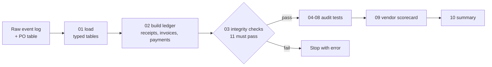

# Accounts Payable Audit in SQL (Procure-to-Pay)

Karthik Bommisetty · UIC MBA (Finance) + MS Business Analytics

I audited nine months of a company's purchasing and payments entirely in SQL: 500 purchase orders, 4,753 process events and $2.57M of spend across 8 vendors. The goal was the question an AP or internal audit team actually gets asked: **where is money leaving the business that shouldn't, and where is spend getting around the controls?**

The data is a practice dataset, not a real company's books (see [About the data](#about-the-data)).

## What I found

**$72.2K paid out that didn't need to be, about 2.8% of spend.**

| Finding | Items | Dollars |
|---|---:|---:|
| Duplicate invoices paid twice | 10 | $41,988 |
| Paid above the PO or the goods actually received | 36 | $17,374 |
| 2/10 Net 30 discounts missed | 102 | $12,365 |
| Net-terms invoices paid >10 days early (5% cost of capital) | 36 | $435 |
| **Total** | | **$72,162** |

**$328K of spend (47 POs, 12.7%) went around a control**, which isn't lost money, but it's money nobody checked:

| Control break | POs | Spend |
|---|---:|---:|
| Invoice arrived before a PO existed (after-the-fact purchasing) | 32 | $179,898 |
| Cancelled after the PO had already gone to the vendor | 12 | $82,082 |
| Over $10K with no second-level approval (4 of the 58 that needed it) | 4 | $69,678 |

I also tested for requesters approving their own POs, the same person receiving goods and clearing the invoice, and price changes with no re-approval. All three came back clean, which is worth knowing too.

### 1. Duplicate payments: the standard check finds none

A duplicate check on exact invoice number, which is what most AP systems already do, finds **zero** duplicates. The second copies were entered as `KP41343`, `POP-041047` or `SLE-41100A` instead of `KP-41343`, `POP-41047` and `SLE-41100`, so they looked like new invoices.

Normalizing the number (strip dashes, leading zeros and trailing letters) finds **10**, all paid a second time, 12 to 18 days after the original, for **$41,988**. A looser test on same vendor + same amount within 45 days found the same 10, which gives me more confidence there are no others hiding.

```sql
-- "AIS-041286", "AIS41286", "AIS-41286A" all become "AIS41286"
CREATE OR REPLACE MACRO normalize_invoice_no(no) AS
    regexp_extract(upper(no), '^[A-Z]+')
    || CAST(CAST(regexp_extract(upper(no), '[0-9]+') AS INTEGER) AS VARCHAR);

SELECT ...,
    ROW_NUMBER() OVER (PARTITION BY vendor_id, normalized_no ORDER BY received_ts) AS copy_no
-- every copy after the first was paid in error
```

### 2. The payment block works, then gets undone

The three-way match compares what was ordered (PO), what arrived (goods receipt) and what was billed (invoice). The most that should ever be paid is the lower of the PO and the receipt. I flagged anything billed more than 2% **and** more than $100 above that, so small invoices don't flood the list and big ones can't hide behind a percentage.

- The payment block caught 73 real exceptions with **$33.3K** of over-billing.
- 44 of them were short-paid to the matched value, so the control saved **$17.2K**.
- 29 were released and **paid in full anyway: $16.1K** overpaid.
- 7 over-billed invoices were never blocked at all ($1.3K).
- 10 blocks were on invoices that were within tolerance, so they slowed things down for nothing.

So the control isn't the problem. Releasing blocks without collecting a credit is.

### 3. Late payments, and a status field I couldn't trust

The source system labels each PO "Paid On Time" or "Paid Late". When I recomputed due dates from the invoice date and payment terms, **17 invoices labeled on time were actually paid 1 to 2 days late**. 13 of them were due on a weekend and paid Monday, and 4 were just late.

So the late-payment rate depends on the rule:

- 145 of 488 (29.7%) counting strictly
- 124 if a weekend due date rolls to Monday
- 128 per the status label, which follows neither rule consistently

I built everything off the dates, not the label. The worst vendors were Summit Lab Equipment (43.9% late), Meridian Logistics (42.6%) and Global Fasteners (37.0%).

On the discount side, only 65 of 167 invoices on 2/10 Net 30 terms got the 2% ($5.9K captured). The other 102 left **$12.4K** on the table.

### 4. Where the time goes

I used `LAG()` over the event log to measure the wait before every step. Leaving out the gap between clearing an invoice and paying it, which is just payment terms working as intended, the biggest waits are goods receipt (median 7 days, 18 at the 90th percentile) and invoice handling.

- **Payment blocks are what actually slow things down.** Blocked invoices take 10.7 days to clear vs. 2.8 for clean ones, and get paid late 38% of the time vs. 28%.
- **Price changes didn't slow anything** (44.9 vs. 45.0 days end to end), which surprised me.
- **Orion Electronics is the slowest vendor end to end** (59 days median), almost all of it from 21-day shipping out of Singapore.

### 5. Who to call first

The vendor scorecard combines every test and ranks vendors by dollars lost. **Pacific Office Partners** ($20.4K, mostly 4 duplicates) and **Keystone Packaging** ($18.6K, 8% of its spend) are first. Summit Lab Equipment and Global Fasteners have the most match exceptions and late payments, but lose less money per dollar spent.

## How it's built

Everything runs in [DuckDB](https://duckdb.org) with one command, from raw files to results:

```bash
duckdb ap_audit.duckdb < run_all.sql
```



| File | What it does | SQL used |
|---|---|---|
| [`01_load.sql`](sql/01_load.sql) | Loads the PO table and event log into typed tables | `read_csv`, casts, `ROW_NUMBER` |
| [`02_build_ledger.sql`](sql/02_build_ledger.sql) | Builds goods receipts, invoices and payments from the event log | macros, hashing for repeatable values, `DECIMAL` money |
| [`03_checks.sql`](sql/03_checks.sql) | 11 integrity checks (orphans, one PO create per PO, payments tie out...). The run stops if any fail | `ANTI JOIN`, `FILTER` |
| [`04_three_way_match.sql`](sql/04_three_way_match.sql) | PO vs. receipt vs. invoice, and how the payment block performed | `least()`, CTEs |
| [`05_duplicate_invoices.sql`](sql/05_duplicate_invoices.sql) | Three duplicate tests, strict to loose | regex, self-join, `ROW_NUMBER`, `first_value` |
| [`06_controls.sql`](sql/06_controls.sql) | After-the-fact POs, missing approvals, cancellations, segregation of duties | conditional aggregation, `UNION ALL` |
| [`07_payment_timing.sql`](sql/07_payment_timing.sql) | Late, early and missed-discount payments, by vendor and month | `RANK`, rolling 3-month window, `quantile_cont` |
| [`08_cycle_times.sql`](sql/08_cycle_times.sql) | Step-to-step waits and the cost of rework | `LAG`, `median` |
| [`09_vendor_scorecard.sql`](sql/09_vendor_scorecard.sql) | One row per vendor, ranked by dollars lost | multi-CTE joins, `RANK` |
| [`10_summary.sql`](sql/10_summary.sql) | The one-page answer above | |

Every result table is also written to [`output/`](output/) as a CSV.

### Choices that changed the numbers

- **Money is `DECIMAL`, not floating point**, so totals tie to the cent.
- **The 2% + $100 tolerance needs both tests.** Either one alone flags too much or too little.
- **Due dates are recomputed, not read from the status field**, for the reason in finding 3.
- **The control-break total counts each PO once.** One PO broke two controls, so adding the rows would overstate it by $3.6K.
- **The integrity checks gate the run.** If the ledger doesn't tie back to the event log, nothing downstream gets calculated.

## About the data

This is a practice dataset. The purchase orders and event log (500 POs, 4,753 events, January to September 2026) are synthetic, with process problems built in to find. Real P2P data is confidential.

The event log has timestamps but no dollar amounts on receipts, invoices or payments, so [`02_build_ledger.sql`](sql/02_build_ledger.sql) builds that ledger in SQL from each PO's value. It uses a hash of the PO number instead of `RANDOM()`, so it produces the same ledger every run. That means the dollar findings show the method, not a real company's losses.

I first looked at this same process in Celonis while learning process automation. The audit here is all SQL. A small Celonis side project, a live currency converter built with an Action Flow, is in [`celonis-side-project/`](celonis-side-project/).

## Repo layout

```
├── run_all.sql        # runs everything, writes output/
├── sql/               # 01-10, one step per file
├── data/              # raw PO table and event log
├── output/            # every result as CSV
└── celonis-side-project/  # small Celonis Action Flow build (currency converter)
```
