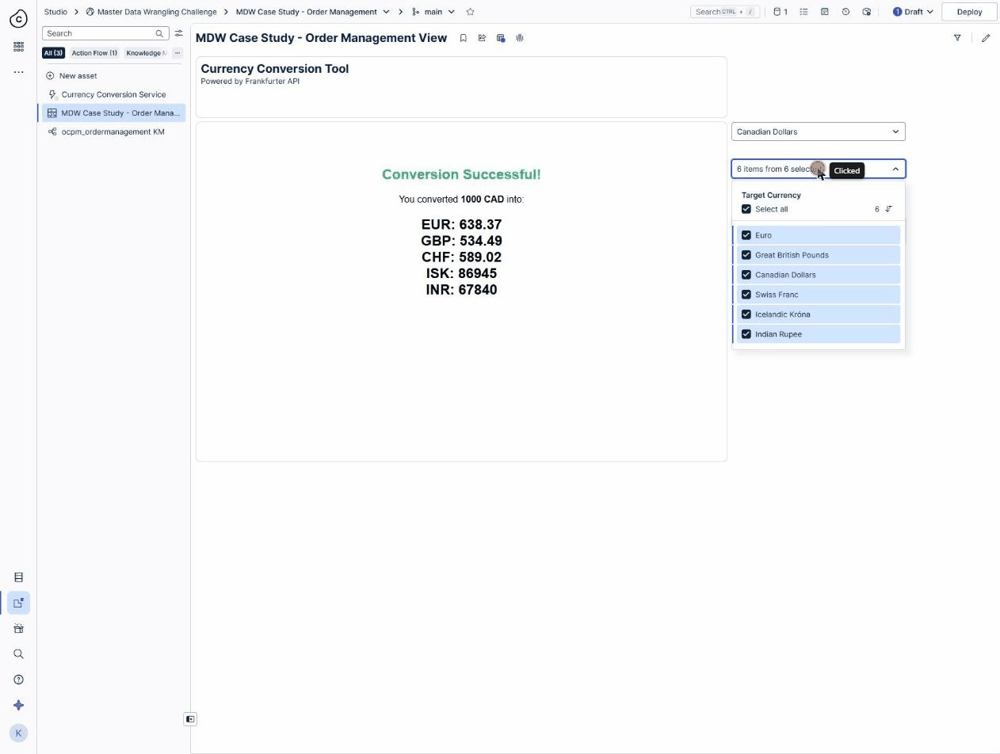
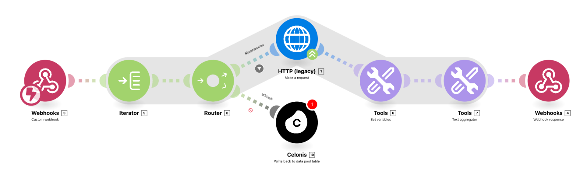
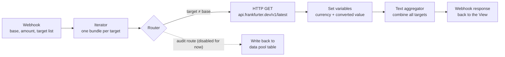

# Live Multi-Currency Converter (Celonis Action Flow)

A side project I built inside Celonis Studio while learning process automation. A Studio View takes a base currency, an amount, and up to six target currencies. The View calls an Action Flow through a webhook, the flow pulls live ECB reference rates from the [Frankfurter API](https://frankfurter.dev), and the results come back to the View in one response.

*Live run: base CAD, targets toggled, then all six selected (including CAD itself, the case that used to crash) and the amount changed. Results refresh on each change.*

## How the flow works

1. **Webhook** receives the base currency, amount, and the list of targets from the View.
2. **Iterator** splits the target list so each currency is handled on its own.
3. **Router** checks each target before any API call is made (see the bug below).
4. **HTTP GET** calls Frankfurter with `from` = base and `to` = the target.
5. **Set variables** pulls the target code and converted value out of the JSON response.
6. **Text aggregator** joins every result into one block.
7. **Webhook response** sends it back to the View, which shows the "Conversion Successful" panel.

## The bug I fixed

The original flow worked for 1 to 5 currencies, then broke once all 6 were selected. The View suddenly showed a raw JSON error instead of results, which at first looked like the component had switched into a code view.

Going through the run history showed what was actually happening. All 6 included Canadian Dollars, which was also the base currency, so the flow asked Frankfurter to convert CAD into CAD. Frankfurter rejects that with **`422 Unprocessable Entity – "bad currency pair"`**, the HTTP module errored, and the whole run rolled back. The View then displayed the failure response as-is.

**Fix:** I added a router in front of the HTTP call with a filter that only lets a target through when it is different from the base (`substring(target; 1; 4)` not equal to `base`, case-insensitive). A target that matches the base is skipped instead of crashing the run. I shipped this as package version **1.0.1**, then re-tested with base CAD and all 6 targets selected. All 5 valid conversions came back with no errors.

## Known issue

If every target currency is unticked, the flow still runs with an empty list and fails with the same raw error screen. It's easy to hit by accident, since clicking "Select all" while only some currencies are ticked clears them all instead of selecting them. The fix is one more check on the router so the API is never called with no targets, plus a friendly "pick at least one currency" message. I'm adding it alongside the audit ledger below.

## What's next

The router already has a second route wired to a **Write back to data pool table** module. The plan is an audit ledger: any invalid or unsupported currency code gets logged (code, base, amount, reason, timestamp) to a Celonis table instead of being silently dropped or breaking the run. That route is switched off until the module's Celonis connection is set up.

## Notes
- Built in a Celonis training team; the workspace needs a login, so these screenshots are the public record.
- Rates are ECB reference rates (updated once per working day), not live trading quotes.
- Based on the Celonis Academy Master Data Wrangling case study; the validation router and bug fix are my additions.
